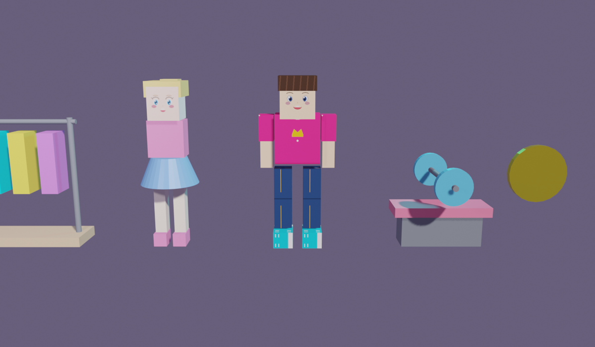
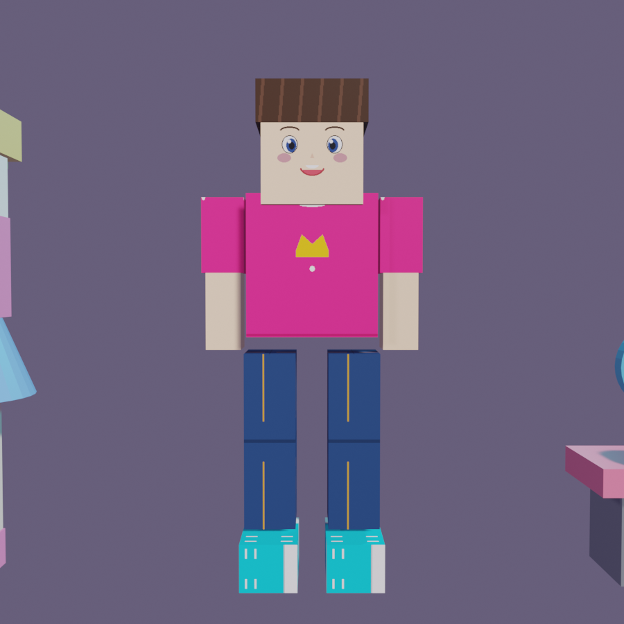

# Get Girls Simulator 🚀

A high-performance 2.5D Isometric Tycoon/Management game built with **TypeScript**, **Three.js**, and **Vite**, engineered for 100% compliance with CrazyGames submission guidelines.

---

## 🌟 Visual Showcase

### Asset Lineup

*Low-poly, high-aesthetic stylized assets: Player Character, Gym Bench with Barbell, Clothing Rack, Girl NPC, and Collectible Coin.*

### Rigged & Textured Player Character

*Humanoid rig (14 bones), 40-frame breathing/sway idle cycle, and custom anime face & streetwear body textures.*

---

## 🏗️ Architecture & CrazyGames Compliance

The engine is engineered with strict adherence to CrazyGames technical standards:

1. **Zero Memory Leaks**:
   - Every Three.js `Geometry`, `Material`, and `Texture` is registered into a disposable resource tracker and released via `cleanup()`.
   - Complete disposal on scene reset/unload.
2. **Zero Runtime DOM Allocation (Object Pooling)**:
   - Dynamic floating text (cash gains, level-ups, notifications) uses pre-allocated DOM pools.
3. **Decoupled Aspect Ratio Resizing**:
   - Uses `THREE.OrthographicCamera` with calculated frustum sizing to prevent stretching or canvas distortion across mobile, tablet, and desktop viewports.
4. **Offline SDK Graceful Degradation**:
   - Built-in `CrazyGamesSDKManager` abstraction automatically falls back to offline simulation when running outside the CrazyGames portal or in local development.

---

## 📁 Project Structure

```
├── Blender-mcp/         # Official Blender MCP submodule (bridge & add-on)
├── docs/
│   └── previews/        # Rendered visual showcases & preview images
├── public/
│   └── assets/
│       ├── models/      # Exported .glb 3D models
│       └── textures/    # Game textures
├── scripts/
│   └── generate_all_assets.py # Blender 3D procedural generation pipeline
├── src/
│   ├── main.ts          # Core 2.5D isometric Three.js game engine
│   ├── style.css        # Responsive HUD & UI overlay styling
│   └── vite-env.d.ts    # TypeScript environment declarations
├── gameassets.blend     # Master Blender 3.1 asset file
├── assetgeneration.md   # Asset generation specification
├── mechanics.md         # Core gameplay loop & economy mechanics
├── monetization.md      # CrazyGames ad placement & monetization design
├── prd.md               # Product Requirements Document
└── vite.config.ts       # Vite build configuration
```

---

## 🛠️ Development Setup

### Web Game Engine
```bash
npm install
npm run dev
```

### Blender Asset Pipeline
The 3D assets are modeled in Blender 3.1 using the single-source `Blender-mcp` bridge:
- Target Python: **Python 3.9** (`Python 3.9.10`)
- MCP Listener: `127.0.0.1:9877`
- Generation Script: `python scripts/generate_all_assets.py`

---

## 📜 License
MIT
